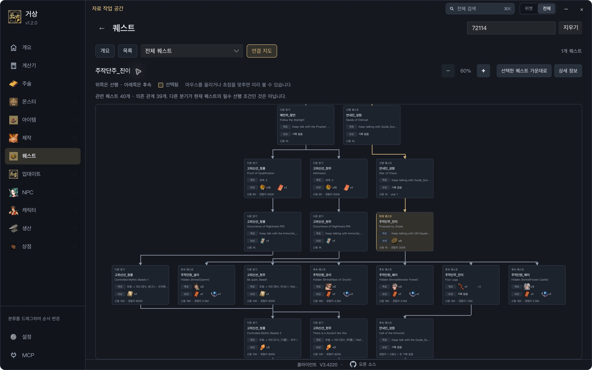
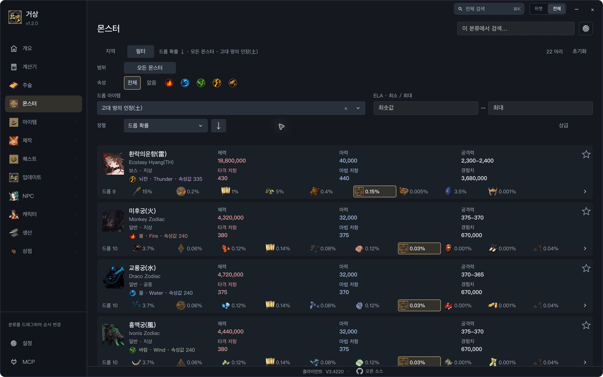

# Gersang

A desktop reference for Gersang items, monsters, quests, and characters. Choose Chinese, English, or Korean, with an optional second language. The bundled catalog and pictures work without the game installed.

[Download for Windows](https://github.com/coreyjj1679/gs-widget/releases/latest) · [Build from source](#build-from-source) · [Usage reference](docs/REFERENCE.md) · [AI / MCP setup](MCP.md)

## Download and launch

1. Download **`gs-widget-v<version>-windows-x64.zip`** from the [latest release](https://github.com/coreyjj1679/gs-widget/releases/latest).
2. Extract the whole ZIP to a writable folder, such as `%LOCALAPPDATA%\Programs\gs-widget`. Keep `gersang-widget.exe` and `data` together.
3. Open **`gersang-widget.exe`**. No Git, Rust, or game installation is needed.

Use the Windows ZIP asset; GitHub's **Source code** downloads are for developers. On launch, the app checks for updates in the background and asks before downloading a new version. Choose **Later** to keep using the app, or manage updates in **Settings → App**. Personal settings are stored separately in `%LOCALAPPDATA%\gs-widget`.

## Quest roadmaps

Follow prerequisites and branches, preview objectives and rewards, and open linked items, monsters, or NPCs directly from the preview. Click a task to open its details. [See the quest preview](docs/REFERENCE.md#quest-roadmaps).



## Monster catalog and drop comparison

Search **古土** in the drop-item filter, select **Ancient Earth Seal**, and compare monsters by **Drop rate ↓**. The selected drop is highlighted on each card. Screenshots use Korean as the primary language and English as the secondary language, set in **Settings → Look → Languages**.



## Build from source

Install [Rust](https://rustup.rs) **1.92 or newer** and Git. On Windows, install Visual Studio Build Tools with **Desktop development with C++** and the Windows SDK; see the [Windows build guide](WINDOWS.md#build). On macOS, install the Xcode Command Line Tools with `xcode-select --install`.

```sh
git clone https://github.com/coreyjj1679/gs-widget.git
cd gs-widget
cargo run --locked --manifest-path widget/Cargo.toml
```

Keep the repository's `data` folder in place. Add `--release` for an optimized build. macOS currently uses this source-build workflow.

## Documentation

- [Usage, languages, catalog data, and diagnostics](docs/REFERENCE.md)
- [Windows builds, releases, and updates](WINDOWS.md)
- [AI assistants / MCP setup](MCP.md)
- [UI design rules](DESIGN.md)
- [Release notes](release-notes.json)

Development happens on `develop`; `main` is the released baseline. See the [release process](docs/REFERENCE.md#build-from-source) before publishing a version.
