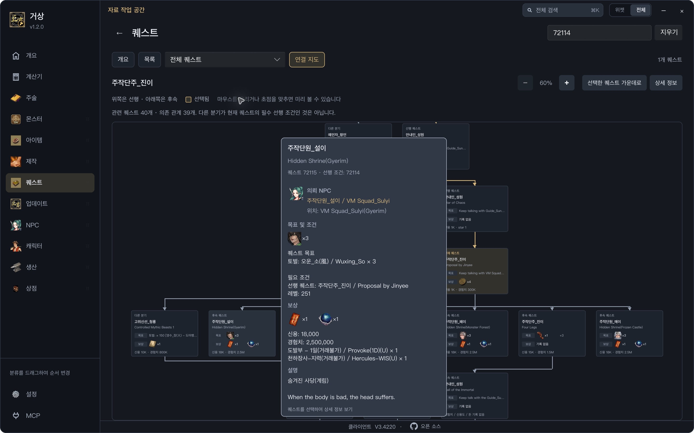

# Gersang reference

Detailed usage, catalog data, maintenance, and performance diagnostics. For downloads, screenshots, and a quick start, see the [README](../README.md).

- [Windows installation and updates](#download-for-windows)
- [Development and releases](#build-from-source)
- [macOS](#macos)
- [Interface and MCP](#interface)
- [Catalog data](#data)
- [Performance diagnostics](#performance-diagnostics)

The catalog is `data/gersang.db`. Pictures are in `data/client`. Paths and commands below are relative to the repository root unless a different working directory is specified.

## Download for Windows

1. Open [Releases](https://github.com/coreyjj1679/gs-widget/releases/latest) and download **`gs-widget-v<version>-windows-x64.zip`** from the latest release.
2. Extract the entire ZIP to a writable folder, such as `%LOCALAPPDATA%\Programs\gs-widget`. Keep `gersang-widget.exe` and `data` together.
3. Open `gersang-widget.exe`. Windows users do not need Git, Rust, Visual Studio, or the game installed. Use the compiled `gs-widget-…-windows-x64.zip` asset; GitHub's **Source code** downloads are for developers.

Each launch checks for updates in the background. When a newer version is available, a download icon and version appear at the bottom left of the navigation bar. The currently installed app version is shown below the app name at the top left. Offline or failed background checks remain quiet; the local catalog, pictures, favourites and settings stay available. You can also check manually under **Settings → App / 設定 → 程式**, where failures are shown with a retry option. Opening an external website, such as the source repository, also requires an internet connection.

Choose **Download update / 下載更新** when you want the new version. Once the download is verified, choose **Restart and update / 重新啟動並更新**. The app restarts into the new version; downloads do not interrupt browsing or restart the app automatically. Updates currently support the Windows x64 release.

Favourites, aliases, language, shortcuts, and window settings are stored in `%LOCALAPPDATA%\gs-widget`, separately from the app's replaceable catalog and pictures. The first launch migrates settings found beside the old catalog without deleting the original files or replacing existing settings. Keep the old `data` folder in place for that first launch. To back up your personal data, copy `%LOCALAPPDATA%\gs-widget` while the app is closed.

See [WINDOWS.md](../WINDOWS.md) for Windows build, release, update, and runtime verification instructions.

## Build from source

Windows developers need [Git](https://git-scm.com/download/win), [Rust](https://rustup.rs) **1.92 or newer**, and [Visual Studio Build Tools](https://visualstudio.microsoft.com/visual-cpp-build-tools/) with **Desktop development with C++** and the Windows SDK (`rc.exe`). From PowerShell:

```powershell
git clone https://github.com/coreyjj1679/gs-widget.git
cd gs-widget
cargo build --locked --release --manifest-path widget/Cargo.toml --target x86_64-pc-windows-msvc
.\widget\target\x86_64-pc-windows-msvc\release\gersang-widget.exe
```

Day-to-day development happens directly on `develop` while this project has one developer. Keep `main` as the released baseline; move changes from `develop` to `main` only when preparing a release. A normal push to `develop` does not publish a release.

For maintainers, write the next version's user-facing changes in [`release-notes.json`](../release-notes.json), with paired English (`en`) and Traditional Chinese (`zh-TW`) entries. Put the newest stable version first, use a `YYYY-MM-DD` release date, and group changes under `added`, `improved`, or `fixed`. Each English bullet must have its Chinese counterpart at the same position. Keep earlier entries so the app can show its bundled release history offline. Do not describe unshipped work as part of an older release.

Bump the package version in `widget/Cargo.toml` and its `gersang-widget` entry in `widget/Cargo.lock`, then validate the notes with `python scripts/release_notes.py --version X.Y.Z` (replace `X.Y.Z` with the version being released). Add `--render` to preview the exact English GitHub Release description. Merge and push that release commit to `main`, then create and push the matching stable tag, `vX.Y.Z`.

Only version-tag pushes trigger the Windows GitHub Actions workflow. It verifies the tagged commit is already in `origin/main` history, checks that the tag matches the package version and has complete bilingual notes, then runs the tests and ZIP packaging. It creates a draft Release titled with the tag, verifies the uploaded ZIP's digest, and publishes the English notes from the same file embedded in the app. The app's release history follows the player's interface language setting; historical release content falls back to English when Korean is selected. Commit messages are not used to generate notes, and existing public releases are never overwritten. Ordinary pushes to `main`, feature or development branches and pull requests do not run this workflow; manual dispatch is disabled.

## macOS

Install the Xcode Command Line Tools with `xcode-select --install`, then install [Rust](https://rustup.rs) **1.92 or newer**. Open a new terminal and check `rustc --version`; run `rustup update stable` if needed.

```sh
git clone https://github.com/coreyjj1679/gs-widget.git
cd gs-widget/widget
cargo run --locked
```

From the repository root, you can instead run `cargo run --locked --manifest-path widget/Cargo.toml`. For an optimized build, run `cargo run --locked --release` from `widget`.

The F1–F9 shortcuts may require holding Fn/Globe, depending on your keyboard settings. macOS or another app may already use some function keys; use the widget's category buttons if a shortcut is unavailable.

## Interface

### AI assistants / MCP

The app includes a local, read-only MCP server. In **Full / 完整** mode, choose **MCP** at the bottom of the sidebar for Codex, Cursor and Claude setup instructions. Copy buttons use this installation's actual executable and catalog paths. The compact widget has no MCP page.

The same executable runs without a window when an AI client launches it with `--mcp`. It provides catalog search, details, monster drops, quest dependencies, recipes and cost calculation from user-supplied prices. The development version adds `query_catalog`: pass the player's original short question (for example `雀天要點合？`) to resolve reviewed game terminology and retrieve direct acquisition requirements in one call, or pass keys for batch comparison. It also supports complete paginated relationships, town/facility details, category-specific search filters, sectioned numeric stats/skills/set effects, and single-call item quantity calculations. Explicit drop/shop/craft questions fetch only relevant source types; ambiguous names and recipes remain choices. Reviewed terms are maintained in `data/terminology.json`; an optional complete external glossary can be updated independently and loaded by restarting MCP, while personal item aliases remain separate. You do not need Node.js, Python, an API key or a separate server. See [MCP.md](../MCP.md) for desktop setup, limitations and verification, and the [release notes](../release-notes.json) for tools included in your installed version.

### Browsing and languages

Use **Full / 完整** for the desktop workspace: persistent category navigation, category search, monster comparisons, and a list beside the selected record's details. The overview provides quick entries and saved monsters. Full mode supports windows down to 960 × 640 logical pixels.

**Search everything / 搜尋全部** (the title bar, the overview, or **Ctrl+K**, also **⌘K** on macOS) searches items, monsters, characters, quests, NPCs and sets at once. Each group shows its closest five matches and its real count, with **Show all** opening that category's search. Reviewed community nicknames from `data/terminology.json`, such as `雀天`, are listed first with the record they name. Use ↑/↓ and Enter to open a result; Back returns to the page you searched from. From the overview, settings, Calculate or MCP, a result opens in its own category.

Open **Enchantments / 鬼道** from the client's Black Tortoise scroll icon in the left navigation, or from the compact home screen. **Scroll categories / 秘訣分類** groups all 135 scrolls by their client artwork: Blue, Green, Red, Yellow, Brown, Other, then Events (including anniversary scrolls). Lists put all scrolls with explicitly linked applicable equipment first and all scrolls without it at the bottom, sorting each set by minimum level. In full mode, each scroll row shows its added abilities as wrapping text above clickable equipment and material icons, with names on hover and material quantities beneath the icons. Ability previews preserve negative modifiers, exclude equipment requirements, and distinguish missing records from known profiles without numeric bonuses. Success percentages stay visible and use red at 20% or below, yellow at 21–49%, and green at 50% or above in the list and scroll details. **All records / 全部資料** keeps separate scroll and equipment directories, including all 1,317 client equipment records. Search by scroll, equipment or material name. Details show success rates, materials, applicable equipment, added abilities and equipment requirements; related items link in both directions. Records without an explicit client scroll reference stay marked as unspecified or missing.

Use **Widget / 小窗** for the compact interface, or **–** for the floating category bar. Full and widget modes share the same slate colors, bronze accents and control styling while keeping their different layouts and density. The floating bar uses the same palette with a translucent background; your window opacity setting still applies. Both systems share the Slint interface; macOS uses PingFang TC and Windows uses Microsoft JhengHei UI. See [DESIGN.md](../DESIGN.md) for the implemented design tokens and layout rules.

In **Settings → Look → Languages**, choose a required **Primary language** and an optional **Secondary language** from **中文 / English / 한국어**. The interface follows the primary language. New installations default to Chinese as the primary language and English as the secondary language; saved language choices are preserved. Choose **None** for the secondary language to show one name only; alternate lines, separators and alternate-name copy actions disappear. The secondary choices exclude the primary language. Missing or identical secondary translations are omitted. If the primary translation is missing, the app uses the selected secondary, then an available English, Chinese or Korean name. Existing Chinese-first/English-first preferences migrate without changing their order. Widget mode keeps compact **Details / Related** tabs (or **Pieces** for sets).

Full-mode monster drop icons and compact Legacy drop names show the selected languages on hover. Expanded drop lists show the primary and secondary names on separate lines, following the selected language order.

Korean catalog names are available for monsters (844), NPCs (1,133), characters (311), maps (400), towns (411), sets (169), and 11,067 usable items. The 97 item entries whose source name is `0` are placeholders. Of 933 quests, 875 have Korean titles and 44 more resolve through their character codes; 14 dispatch titles require fallback. Korean source descriptions exist for 10,016 items and 798 quests. GTS-only skill descriptions, location text and some quest details do not have Korean translations in the bundled database, so these fields use the same fallback rule. Game update lines have all three languages. No catalog translations are generated or written back to the read-only database.

In full mode, catalog search keeps the category directory and current preview visible. Search covers the whole category and lists every match, closest first: an exact code or alias, a whole name, a name start, then other matches; the result count is the real count. Clearing it restores the previous browsing section and scroll position. Empty results offer a clear-search action. Select a category on the left to leave search and browse it. Crafting, production, and usage groups can be expanded directly in item previews. Item, set, quest, recipe, NPC, hero, and other supported record previews provide **Open details**, and Back returns to the selected preview.

The full-mode **Calculate** page has **Items**, **Characters / Mercenaries**, and **Bonus / 紅利** tabs. The item tab keeps its saved sheets, nested recipes and sharing tools. The character tab lists acquisition, combination, promotion and awakening routes from the local catalog, with prerequisite characters, materials and conditions. Enter each prerequisite character's full acquisition cost and each item's unit price; earlier character chains are not expanded automatically. Missing fees stay unknown until entered, and alternative-material groups ask for the selected materials' combined cost. These two cost tabs retain their own calculations, with accepted quantities and prices preserved across restarts; blank prices are unknown and `0` explicitly means no additional cost.

**Bonus / 紅利** is in beta; the page recommends cross-checking with other calculators in the player’s primary language (Chinese, English or Korean). It displays a target’s material chains side by side as a compact connected promotion tree, including the 15 recorded Legends. Edit levels directly in each node; **All Lv. 200**, **Max levels**, and **Reset** compare scenarios. **White robes 300** appears for eligible materials; it sets all of them to 300 and models Indian white-robe training before conversion. **Least XP perfect** applies one jointly attainable configuration that minimizes total leveling experience for the selected route while retaining the maximum final integer bonus. It uses the production client experience table and assumes white-robe training is already complete; retraining, hiring, items, and other promotion requirements are outside this theoretical objective. Statue nodes charge an XP estimate for training the sealed source from level 1 to the recorded level; the source’s earlier formation history is excluded. Known promotion minima also apply to the **All Lv. 200** action, so materials that require 260 stay at 260. Max levels respects each material’s cap: normally 250, Four Kings / Wisdom Kings / Legends 260, and statues 200. Nine Indian ordinary mercenaries have four alternative former mercenaries; choose one of four small portraits in the source node and enter its conversion level (100–250). Switching sources retains each source’s draft. Select a node and open **Advanced / formula** to inspect the arithmetic or override its actual inherited points. Blank means automatic; `0` explicitly replaces earlier history with zero.

The fixed result compares the final integer against the calculated maximum. **Perfect without rebirth / 無重生完美** means equality after every promotion rounds down; earlier materials need not all reach their level caps. Geota cross-checks and independent regression cases include Meng Huo 1013, Razia 1080, and awakened Wisdom Kings 955 / 968 / 956 / 976. Unknown rules and manually entered history do not receive a perfect badge; targets whose full white-robe history is not modeled show a clearly labeled no-white / no-rebirth reference instead. Legend maxima include 300 white-robe points per material. For Indian materials, explicitly select **White robes completed before conversion to India** to model that route; if white robes were used later, enter the actual non-white inherited bonus. Rebirth, equipment and skin bonuses are excluded. The worksheet retains inputs while switching tabs and languages in the current session. **Evidence / 計算依據** opens the offline provenance and assumptions panel. It separates client-confirmed data from rules that still rely on cross-checks, and offers an optional Geota link. See [formula sources, verification cases and limitations](bonus-formulas.md).

In full mode, open an item or set to see its picture and bilingual name in a horizontal header, with attributes on the left and sources or pieces on the right. Both columns stay visible and scroll independently. **Tab** switches keyboard focus between them without resetting their scroll positions. The catalog preview also provides **Open details** to reach this page.

Item source and use groups list every record, and each group heading shows the real count. Drop sources show each monster's highest recorded rate for the item, highest first, with unrecorded rates last. **Compare by drop rate / 依掉落率比較** opens the monster page's drop filter for that item, sorted by rate; Back returns to the item. Opening a monster from an item selects and scrolls to that item's drop row.

Full-mode settings expand with the window. Look, Bar and App use grouped columns when space allows, then stack at narrower widths; alias rows use the available width with the same editor. The App page places update controls beside the changelog. All nine bar entries remain reachable by scrolling at 960 × 640. Resizing keeps the scroll position within the new content bounds, while widget settings keep their compact layout.

Settings support **Tab / Shift+Tab** to move between controls and **Ctrl+Tab / Ctrl+Shift+Tab** to switch pages. On the selected settings tab, arrow keys and Home/End select a page. Choice bars use arrow keys and Home/End; buttons use Enter or Space. The opacity slider uses arrow keys for 1%, Page Up/Down for 10%, and Home/End for 25%/100%. Focused controls scroll into view. In Bar settings, Space toggles an entry and **Alt+↑/↓** reorders it. Home in a search field keeps its text-editing behavior.

Catalog and related-result rows keep their compact heights. Hover to read complete bilingual names and source information, or focus a row and press **Ctrl+I** (also **⌘I** on macOS); **Esc** closes the information panel without leaving the page. Catalog rows support Tab focus, ↑/↓ navigation and Enter/Space to open the preview.

### Quest roadmaps

Open a quest's **Roadmap** to follow its prerequisites and subsequent branches. Click a task card to open that quest's details. Hover or focus a task to see its objectives, requirements, rewards, quest giver, and recorded NPC location. Item and monster icons and the quest giver in the preview open their own details; Back returns to the roadmap. Missing names, locations, or artwork remain marked as unavailable rather than inferred.



### Copy names

Left-click a name in a record's detail heading to copy that name. Chinese and English headings copy separately, including item, quest, character, NPC and monster names; recipe headings copy the result item's name. Only the canonical name is copied, without IDs, quantities or descriptions. Hover to see the full name and copy hint, or focus the name and press Enter, Space or Ctrl+C. Existing list and related-record links continue to open their records.

Copy feedback appears at the bottom centre of the content area (beside the sidebar in Full mode). Names stay borderless.

### Characters, mounts and spirits

The character directory includes **Mounts** and **Spirit**, with a fixed representative portrait for each category where an image is available. Select a character for a preview, then choose **Open full details** to view its portrait, base stats, skills and progression materials. Chinese and English names copy separately. The compact widget opens the same scrollable detail page. Mount lists show the required riding level and movement bonus, ordered by riding level. Spirits are grouped by their spirit family element and ordered by grade; this family can differ from a low-grade spirit's combat element. Spirit skill effects appear first, with base stats available under **Show base stats**.

The bundled catalog contains base stats for 263 characters and 33 spirit forms, plus 15 mounts with their recorded bonuses, riding requirements and materials. Unknown fields are omitted; mount bonuses are not presented as character base stats. These records come from the local parsed game database, rather than the older reference websites. Maintainers can refresh them transactionally with `python3 scripts/import_character_data.py /path/to/gersang-full.db` (see `--help` for options).

Character, spirit and mount portraits use the bundled portrait atlases. The bundle also includes animation sheets for all 33 spirit forms and base mount artwork for all 15 mounts, with a play/pause control. Mount previews show the base artwork; the game's additional layered glow effects are not composited. Other character animations can be supplied through `GERSANG_CLIENT` or `data/client.txt`. Configured client paths are checked case-insensitively when an asset is absent from the bundle. Missing assets show an unavailable message, and fully transparent animation frames are skipped.

In the region directory, expand a region to choose a rank, using the same rank order as the rank tab. Region and rank portraits and counts use only characters in that region. Select the region itself to see all its characters in rank order. The compact widget retains step-by-step region → rank → character navigation.

Each spirit's **Upgrade to this spirit** section lists the previous form, required intimacy and materials needed to reach the selected form. A grade-five spirit shows its grade-four-to-five recipe; its previous form shows the grade-three-to-four recipe. The next-form link remains available, and first forms omit missing prerequisite data.

## Data

Crafting workshop recipes include the required recipe book, materials, batch yield, fee, production days and recorded friendship requirement. Books link to the recipes that use them, and each recipe links back to its product. Refresh the 51 bundled workshop recipes from `Makingfacility.txt` with `python3 scripts/import_facility_recipes.py --full-db /path/to/gs-parser/data/gersang-full.db`. The source is opened read-only; the importer preserves other recipe IDs and updates its own tables transactionally. `meta.facility_recipes_source` records source hashes and coverage. Village names retain the source Korean where no explicit town-code mapping is available.

Monster drops show the client catalog's recorded percentage beside each item. Unmatched rates appear as **未記錄 / Not recorded** (or **—** in the icon strip); they are not treated as zero. Single-player drops retain their existing label. These are the client's base values, before any in-game bonuses or events.

In full-mode monster filters, search the drop-item dropdown by name, alias or item code (for example `#11608`). It lists only items with monster drop sources. Selecting an item filters its monsters and sorts their recorded drop rates from high to low; the sort direction can be reversed, and unknown rates always remain last. The selected drop is highlighted in each monster's drops. If an item occurs in multiple slots, sorting uses the highest recorded slot rate, without adding different conditions together.

To refresh rates after replacing the catalog, run `python3 scripts/import_drop_rates.py /path/to/gs-parser/data/gersang-full.db --target data/gersang.db`. The importer matches monster and item codes within the same normal/single-player drop mode, preserves existing drop rows, and stores the original integer in `monster_drops.drop_rate_per_100000` (`5500` means `5.5%`). Source metadata is recorded in `meta` under `drop_rates_source`. Map-specific boss rewards and reward pools are not merged into per-monster rates.

Enchantment (鬼道) data comes from the local client archive in `data/gcs/gersang.gcs`. Refresh it with Python **3.10 or newer** and a `gs-parser` checkout:

```sh
python3 scripts/import_enchant.py --parser-root /path/to/gs-parser
```

The importer also discovers a sibling `gs-parser` checkout automatically. Use `--client /path/to/static` for another client archive or `--target /path/to/gersang.db` for another existing catalog. All eight enchantment tables and the source metadata are refreshed in one transaction; a failed import rolls back both schema and data. `meta.enchant_source` records the archive SHA-256, individual decoded table hashes and coverage counts. Ordinary crafting and reinforcement recipes are kept separately.

`enchant_equipment` connects the source's result, base equipment, scroll and ability profile by their explicit codes. `enchant_effects` preserves the additive ability values, equipment requirements and inheritance flags. `v_enchant_equipment` joins these with scroll requirements; `v_enchant_materials` lists each scroll's additional materials. Join the views on `scroll_item` to query the complete recorded chain. Scroll usage level and resulting equipment level are separate fields. Restoration-scroll and jackpot-result codes are also separate; no jackpot probability is inferred.

Every uncommented source equipment row is retained, including results absent from the item directory. Availability flags identify those catalog gaps. `scroll_status` is `linked`, `no_scroll` for a source code of zero, or `missing_scroll` for an explicit code without a scroll recipe. A zero code is never filled by matching names. Decimal experience and enchantment modifiers retain their original numeric text; NPC success weights remain raw values. Ability columns take precedence over potentially stale description text, and negative stats are preserved.

The first source build downloads dependencies and can take a few minutes. Keep the repository's `data` folder in place: the program locates the catalog from the executable or working directory. You can also set `GERSANG_DB` to the catalog file's path. Windows preferences are stored under `%LOCALAPPDATA%\gs-widget`; macOS preferences remain beside the active database.

Window positions are saved separately in `window.txt` on Windows and `window-macos.txt` on macOS, so Retina scaling does not affect the Windows layout. The app version is separate from the catalog's game data version.

The bundled pictures and mount/spirit previews work without the game. Other optional battle animations need additional client assets; set `GERSANG_CLIENT` to the client root or put that path in `%LOCALAPPDATA%\gs-widget\client.txt` on Windows, or `client.txt` beside the active database on macOS.

## Performance diagnostics

Run these with an optimized build (`cargo build --locked --release --manifest-path widget/Cargo.toml`) when investigating a user's machine. Compare the same catalog, renderer, window size, build profile, and hardware. Debug-build timings are useful for regression comparisons but are not release latency estimates.

- `gersang-widget --profile-catalog catalog-profile.json` writes local JSON with catalog startup, every category and populated section, fuzzy search, monster-card preparation, and cold/warm image decoding timings. It runs without opening a window. Normal first-launch preference initialization/migration applies. The image sample is deterministically sorted and capped at 1,000 distinct frames; failed decodes are counted. “Cold” means a fresh process cache, not a cleared OS disk cache.
- `gersang-widget --profile-ui ui-profile.json` opens a temporary native window using the Slint software renderer and benchmarks the actual Slint catalog with **synthetic** 50/500/5,000-row lists at 1280×800 and 960×640. It writes JSON plus adjacent PPM snapshots at the top/middle/end. It does not load or save personal settings. This measures model replacement, layout and CPU snapshot rasterization, **not** screen presentation, database work or asynchronous image loading.
- `gersang-widget --profile-pages pages-profile.json` measures real full-mode page models at 1280×800 in Chinese/English: category entry pages, all monsters, all quests, calculator entry with each tab selected, and the four settings tabs. Each page gets one first visit and five revisits separated by a home frame. JSON separates synchronous preparation from software-rendered snapshot time, with startup phases, row counts and three adjacent PPM screenshots. These are page reconstruction measurements, not native click-to-display or image-complete timings: asynchronous image jobs are counted and discarded, no event loop or update checks run, and calculator initialization has already warmed shared caches. Monster All rebuilds its directory too; calculator samples reopen Calculate rather than merely switching its tab. Normal calculator draft migration can apply; use an isolated data directory via `GERSANG_DB` (and isolated `LOCALAPPDATA` on Windows) when preserving an existing test baseline.

To time actual navigation, searches and scrolling, set `GERSANG_PROFILE` to a writable JSONL file and start the app normally. For example, in PowerShell from an extracted Windows package:

```powershell
$env:GERSANG_PROFILE = "$env:TEMP\gs-widget-performance.jsonl"
Start-Process .\gersang-widget.exe -Wait
Remove-Item Env:GERSANG_PROFILE
```

For the headless report on Windows, use `Start-Process .\gersang-widget.exe -ArgumentList '--profile-catalog', 'catalog-profile.json' -Wait` because the application is a GUI executable. On macOS, use `GERSANG_PROFILE=/tmp/gs-widget-performance.jsonl ./widget/target/release/gersang-widget`.

Each JSONL entry contains `process_id`, `since_start_ms`, `stage`, `elapsed_ms`, and `count`. Reproduce the slow action, then close the app. Relevant stages are:

- `navigation.<category>`: identifies the category associated with the following spans without recording the query.
- `startup.catalog_initialize`: user-data initialization and catalog opening.
- `list.query`, `list.monster_cards`, `list.rows`, `list.model_set`, `list.publish`, `list.reload_board`, `detail.open`: nested wall-time spans for data lookup, row preparation, model assignment and navigation. Do not add overlapping spans together.
- `icons.queued`: pending-job count, with zero duration. `icon.decode`, `icon.queue_wait`, `icon.paint`: decoding batches, event-loop queue delay, and applying images to models. Count is jobs or targets, not unique files.
- `ui.render_span`: wall time between the renderer's Before/AfterRendering callbacks. `ui.update_to_render`: earliest instrumented update through the next AfterRendering callback. Neither includes display presentation or guarantees that every icon has finished loading. A backend without notifier support emits `ui.render_notifier_unavailable` instead; no render timing is fabricated.
- `ui.event_loop_delay`: excess delay over a 50 ms UI timer, recorded when at least 20 ms late. OS scheduling, app suspension and sleep also affect it, so keep the app visible and the machine awake while recording.

Logging is opt-in, local and best effort; it records no search text, names or personal settings and sends nothing over the network. A bounded background writer avoids blocking the UI; a saturated queue or abrupt shutdown may drop diagnostics. Disable `GERSANG_PROFILE` after reproducing the issue to stop log growth. The headless catalog report excludes GUI costs, while the synthetic UI report excludes icons and real catalog work; use the runtime trace to diagnose actual interaction latency.

For algorithm comparisons using the bundled assets:

```sh
cargo test --locked --manifest-path widget/Cargo.toml profile_icon_row_updates -- --ignored --nocapture
cargo test --locked --manifest-path widget/Cargo.toml profile_item_frame_decode -- --ignored --nocapture
```

These manual benchmarks compare the previous and current algorithms in one process and check output equivalence. They are not end-to-end loading measurements.
